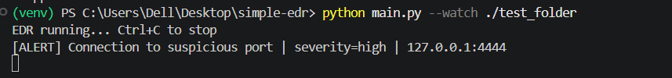

# Simple EDR (Endpoint Detection & Response)

A lightweight, educational EDR agent written in Python. It monitors processes, files, and network connections on Windows/Linux, detects suspicious behavior using YAML rules, logs alerts as JSON, and can optionally respond automatically.

> ⚠️ **For educational purposes only.** Not a replacement for a production security product.

## Features

- **Process monitoring:** detects new processes, known malicious tool names, suspicious parent-child chains (e.g. `winword.exe -> powershell.exe`), and processes running from suspicious paths.
- **File monitoring:** detects executable files dropped on disk and ransomware-like behavior (mass file modification in a short time window).
- **Network monitoring:** detects connections to suspicious ports.
- **Rule-based detection:** all rules live in `rules/rules.yaml`, so no code changes are needed to tune them.
- **Alerting:** events and alerts are written to `logs/*.jsonl`.
- **Response (optional):** kill a malicious process or quarantine a file with `--respond`.

## Architecture

```
 Collectors              Engine               Output
+-----------------+   +--------------+   +------------------+
| Process monitor |   |              |   | Alerts (JSONL)   |
| File monitor    |-->| Rules Engine |-->| Console output   |
| Network monitor |   |  (YAML)      |   | Response actions |
+-----------------+   +--------------+   +------------------+
```

## Project Structure

```
simple-edr/
├── edr/
│   ├── logger.py
│   ├── process_monitor.py
│   ├── file_monitor.py
│   ├── network_monitor.py
│   ├── rules_engine.py
│   └── response.py
├── rules/rules.yaml
├── tests/
├── docs/screenshots/
├── main.py
└── requirements.txt
```

## Installation

```bash
git clone https://github.com/YOUR_USERNAME/simple-edr.git
cd simple-edr
python -m venv venv
venv\Scripts\activate        # Windows
# source venv/bin/activate   # Linux/Mac
pip install -r requirements.txt
```

## Usage

```bash
mkdir test_folder
python main.py --watch ./test_folder            # detection only
python main.py --watch ./test_folder --respond  # with automatic response
```

## Detection Rules

| Rule | Severity | MITRE ATT&CK |
|------|----------|--------------|
| Known malicious tool | High | T1588.002 (Obtain Capabilities: Tool) |
| Suspicious parent-child process | High | T1059 (Command and Scripting Interpreter) |
| Process from suspicious path | Medium | T1036 (Masquerading) |
| Executable file dropped | Medium | T1105 (Ingress Tool Transfer) |
| Possible ransomware behavior | Critical | T1486 (Data Encrypted for Impact) |
| Connection to suspicious port | High | T1571 (Non-Standard Port) |

## Testing

Safe simulations are provided in `tests/`:

```bash
python tests/simulate_ransomware.py     # creates 30 files rapidly
python tests/simulate_connection.py     # opens a connection on port 4444
```

## Screenshots

**Ransomware detection**


**Suspicious process detection**


**Suspicious network connection**


## Limitations

- Uses polling (1-2 seconds), so very short-lived processes or connections can be missed.
- No kernel-level hooks or driver, so it is not tamper-resistant.
- Detection is rule/signature based only (no behavioral ML).
- Ransomware detection counts file modifications and is not content-aware.

## Future Work

- Flask dashboard to view alerts
- SHA256 hashing with VirusTotal lookup
- Unit tests with pytest
- Windows Event Log (Sysmon) integration

## Author

Rahma Medhat : https://github.com/rahma503